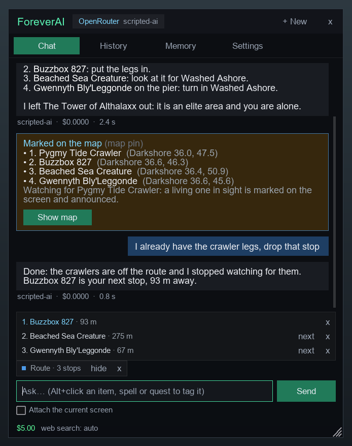
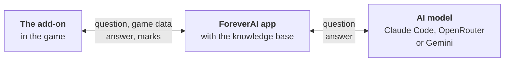
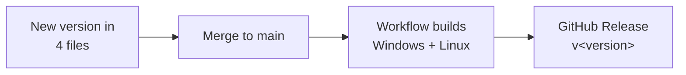

<div align="center">


# ForeverAI

**An AI assistant inside World of Warcraft: Forever that already knows your character.**

[](https://github.com/pawelpieczonka/forever-ai/releases/latest)


</div>

Ask in your own words, in any language. ForeverAI sees your quests, bags, gear and where you stand, so there is nothing to explain first. It answers from a knowledge base of what Forever changed and, with Auctionator, from auction house prices.

## What it does

<table>
<tr>
<td width="410"></td>
<td>

### Tells you what to do next

The answer is about your character as it is now.

- "What should I do next?"
- "Is this ring better than mine?"
- "Which talent do I take now?"
- "Why do I keep dying to this mob?"

</td>
</tr>
<tr>
<td></td>
<td>

### Plans a route and finds the creature

"Plan a route through my quests" puts the stops on your map in the shortest walking order and leaves out what you should not do alone.

- With TomTom, its arrow leads you from stop to stop.
- When quests lead into a city or another zone, the route goes on there, and the portal, boat or flight you take is a stop of its own.
- A creature you need gets a marker over its nameplate, a sound and a chat line when it comes into sight.
- The strip above the text field counts how many are in sight.
- The marks are still there after a `/reload`.

</td>
</tr>
<tr>
<td></td>
<td>

### Changes the route when you change your mind

Click **x** to drop a stop, click a stop to head there first, lock one with the padlock so that it stays, or just say it:

> "I already have the crawler legs, drop that stop."

The route on the map changes. Nothing is planned from scratch.

</td>
</tr>
</table>

<sub>The add-on's window with example answers, taken in the add-on simulator.</sub>

### More things to ask

| Topic | Ask | Good to know |
|---|---|---|
| Leveling | "How long until level 30 at this pace?" | |
| Gold | "How much gold did I make today, and on what?" | |
| Professions | "What do I craft to get Leatherworking to 150 with what I have?" | |
| Auction house | "Find a one-handed sword on the AH that is an upgrade for me, up to 5 gold." | needs an Auctionator scan; Pawn for upgrades |
| Selling | "My bags are full. What can I sell?" | at a vendor; nothing is sold until you click **Accept** |
| Places | "Where do I buy Coarse Thread?" or "Where is the hunter trainer? Mark it." | |
| Memory | "Remember that I play Beast Mastery and level with a friend who plays a mage." | kept for later conversations |
| One thing | **Alt+click** an item, a spell or a quest | the question is about exactly that one |

## How it works



Add-ons cannot reach the internet or other programs. So the add-on puts its question into a screenshot, which the app reads, and the app writes the answer into small helper add-ons (`ForeverAI_Inbox…`) that the add-on loads. That is why the app has to run while you play, and why the game needs one `/reload` after the add-on is installed.

## Get started

**You need:**

- Windows 10/11, or Linux with WoW Forever under Wine (Lutris, Steam/Proton, Bottles, Heroic or plain Wine)
- One AI: Claude Code (Claude subscription), an [OpenRouter key](https://openrouter.ai/keys) or a [Google Gemini API key](https://aistudio.google.com/apikey). See [Choosing the AI](#choosing-the-ai).
- No other add-on is required. [Four of them](#other-add-ons) add quest data, a map arrow, auction prices and upgrade checks.

### 1. Download

From [the latest release](https://github.com/pawelpieczonka/forever-ai/releases/latest):

| System | File | Start |
|---|---|---|
| Windows 10/11 | `ForeverAI-<version>-Windows-x64.zip` | `ForeverAI-Windows/ForeverAI-Windows.exe` |
| Linux, glibc 2.35+ (Ubuntu 22.04, Debian 12 and later) | `ForeverAI-<version>-Linux-x86_64.tar.gz` | `ForeverAI-Linux/ForeverAI-Linux` |

No Python needed. `SHA256SUMS.txt` in the release has the checksums. The app tells you when a newer version is out (**Download update** in its window).

### 2. Start the app and reload the game

<table>
<tr>
<td width="330"></td>
<td>

Extract the file anywhere and start the app. It finds the game and installs the add-on.

Then type `/reload` in the game and click the **AI** button, or type `/fai`.

Keep the app running while you play. **Desktop shortcut** in its window puts it on the desktop (on Linux also in the application menu).

</td>
</tr>
</table>

<details>
<summary><b>Linux:</b> where the app looks for the game</summary>

<br>

In your Wine prefixes (`$WINEPREFIX`, Lutris, `~/.wine`, `~/Games`, Heroic, Bottles, Steam) and on mounted disks. If it does not find the game, choose the `World of Warcraft` folder in its window or start it with `--game-dir`.

The app finds Claude Code on `PATH`, in `~/.local/bin`, in npm/nvm installs and in the Claude desktop app.

</details>

## Choosing the AI

| | Claude Code | OpenRouter | Google Gemini |
|---|---|---|---|
| **You need** | a Claude subscription, Claude Code installed and signed in | an [OpenRouter key](https://openrouter.ai/keys) | a [Gemini API key](https://aistudio.google.com/apikey) |
| **Cost** | included in the subscription | per question, from your OpenRouter credit | Google's API prices for your key |
| **Models** | Haiku, Sonnet or Opus, with a thinking level | a list, or any model by its ID | a list, or any model by its ID |
| **When the model cannot answer** | — | a second model answers | `gemini-flash-lite-latest` answers within seconds |

- At start the app uses Claude Code when it is installed and signed in. Otherwise its window asks for a key and checks it with the provider before saving it.
- **AI settings** in the app window change the provider, the model, the thinking level and web search (Auto, Always or Off). **Keys & sign-in…** adds a key or signs in to Claude Code. Changes apply to the next question. **Route updates** picks another model for the updates the add-on asks for by itself (and, with Claude Code, another thinking level next to it), so that they can be faster or cheaper than your questions.
- Keys stay on your computer, in Windows Credential Manager or the Linux Secret Service (GNOME Keyring, KWallet, KeePassXC). Without one, the key is kept in `.env` in the data folder, readable only by you, and moves to the credential store once there is one.
- When a Gemini answer has not started after 10 seconds, a short test tells an overloaded model from a busy one, so the switch to `gemini-flash-lite-latest` takes seconds instead of a long timeout. The app checks the chosen model again every few minutes and goes back to it once it answers.

## Other add-ons

| Add-on | What ForeverAI gets from it |
|---|---|
| Questie | quests available near you, and where quest creatures, objects and items are |
| TomTom | its arrow and waypoints for marks and routes (otherwise the game's map pin) |
| Auctionator | prices from your last scan (open the auction house and scan first); **Search on the AH** under an answer shows the picks in its Shopping tab |
| Pawn | which items are upgrades for you |

ForeverAI reads other add-ons and never changes their files. Their settings change only through a proposal you accept in the game.

## In the game

> [!IMPORTANT]
> Add-on options, selling, repairing and abandoning a quest happen only after you click **Accept**. Buying on the auction house always stays with you.

| Do this | To |
|---|---|
| **Alt+click** an item, a spell or a quest | add it to your question |
| **list** on the route | see its stops in order, each with what to do there in brackets and its distance; the one you are heading to is lit up |
| a click on a stop in the list | head there: the arrow leads to that stop |
| the padlock on a stop | keep it on the route until you unlock it |
| **x** on a stop | take it off the route |
| the arrows on the route (green or red) | have the AI update the route when your quests change, or not |
| **x** on the strip above the text field | stop tracking, or remove the route |
| **Settings** tab | choose which game data is sent, the font size, the AI button, how new routes start (updated or not), the alerts on the screen, the search beyond nameplate range; see which AI is in use |

**Routes and tracking.** A stop comes off the route when what is to be done there is done (the quest objective, the turn-in, the quest taken), not when you walk past; a stop that is only a place comes off when you reach it, and the way into another zone when you are in that zone. The game has no data on portals, boats and gates, so the AI places them from what it knows and says when a spot is approximate. With the arrows green the route keeps up with your quest log. What the route was made for (an objective done, a quest turned in) ticks its stops off without asking the AI; the AI is asked when a quest was taken or the next step of a quest is not on the route, once for a run of changes, and its answer is one line in the chat. An answer written while you took another quest is not put on the map: the update is asked again, so the route is always the one for your quest log as it is. The quest that follows a turn-in in its chain is planned for: its stop says "turn in …; then pick up …" and stays until you took it. When the AI thinks by itself that the route no longer fits, it proposes the change and you accept or reject it. The add-on watches for every creature that counts for the same quest objective and stops by itself when the objective is done. While it tracks, the game shows the nameplates of all enemies; your own setting comes back afterwards.

| Command | What it does |
|---|---|
| `/fai` | opens or closes the window |
| `/fai <question>` | asks right away |
| `/fai new` | starts a new conversation |
| `/fai stop` | ends tracking and clears the marks |
| `/fai button` | shows or hides the AI button |
| `/fai status`, `/fai track`, `/fai debug` | details for troubleshooting |

## Uninstall

| Delete | Windows | Linux |
|---|---|---|
| The app | the extracted `ForeverAI-Windows` folder | the extracted `ForeverAI-Linux` folder |
| Your data | `%APPDATA%\ForeverAI` | `~/.local/share/foreverai` |
| The add-on | `ForeverAI` and `ForeverAI_Inbox*` in `World of Warcraft/_forever_/Interface/AddOns` | the same |
| Shortcuts | `ForeverAI.lnk` on the desktop | `~/.local/share/applications/foreverai.desktop` and `ForeverAI.desktop` on the desktop |

When the app runs from a git checkout, its data is in `companion/data`.

## Development

Python 3.12+ with your distribution's Tk (Linux: `sudo apt install python3-venv python3-tk`, `sudo dnf install python3-tkinter` or `sudo pacman -S tk`). A standalone Python (uv, python-build-standalone) has a Tk without font rendering, so the window shows bitmap fonts.

```bash
python3 -m venv companion/.venv
companion/.venv/bin/python -m pip install -r companion/requirements.txt
```

| To | Run in `companion` |
|---|---|
| start the app | `.venv/bin/python -m foreverai` |
| run the tests | `.venv/bin/python -m pytest -q` |
| run the add-on outside the game, connected to the app, and save pictures of its window | `.venv/bin/python -m addonsim --help` |

On Windows use `.venv\Scripts\python.exe` instead of `.venv/bin/python`.

<details>
<summary><b>Build the apps</b></summary>

<br>

The built apps are not committed. GitHub Actions (`.github/workflows/release.yml`) builds both from the same commit for every pull request (as workflow artifacts). Local builds go to `release/`, which git ignores. A Linux build runs on distributions with the same or a newer glibc than the machine that built it.

| Platform | Writes | With the flag, also |
|---|---|---|
| Windows | `release\windows\ForeverAI-Windows\` | `-Package`: the release zip |
| Linux | `release/linux/ForeverAI-Linux/` | `--package`: the release archive |

Windows:

```powershell
python -m venv companion\.venv
companion\.venv\Scripts\python.exe -m pip install -r companion\requirements.txt pyinstaller -c companion\constraints.txt
.\build_exe.ps1 -Package
```

Linux:

```bash
python3 -m venv companion/.venv
companion/.venv/bin/python -m pip install -r companion/requirements.txt pyinstaller -c companion/constraints.txt
./build_linux.sh --package
```

Both apps bundle the starter knowledge base `seed/kb.sqlite`. When `companion/data/kb.sqlite` exists, the app uses that one instead.

</details>

<details>
<summary><b>Publish a release</b></summary>

<br>



1. Set the new version in `addon/ForeverAI/ForeverAI.toc`, `ns.version` in `addon/ForeverAI/Core.lua`, `companion/foreverai/__init__.py` and `companion/pyproject.toml`. A test checks that they agree.
2. Merge to `main`. Since this version has no release yet, the workflow publishes `v<version>` (it creates the tag) with both files and `SHA256SUMS.txt`.

A push to `main` with a version that is already released only builds the apps. Pushing a tag `v<version>` that matches the version in the source publishes it as well.

</details>
