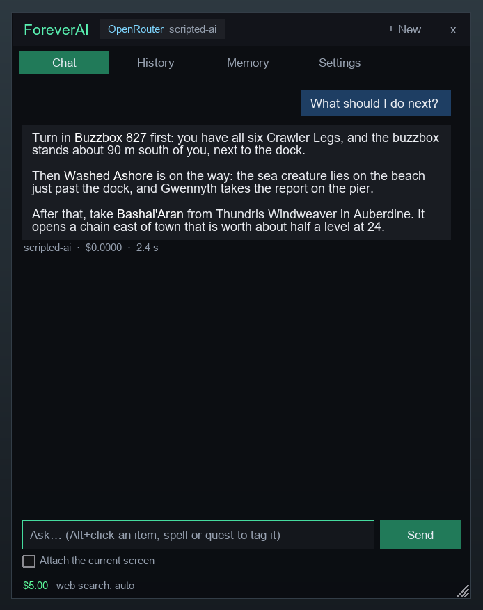
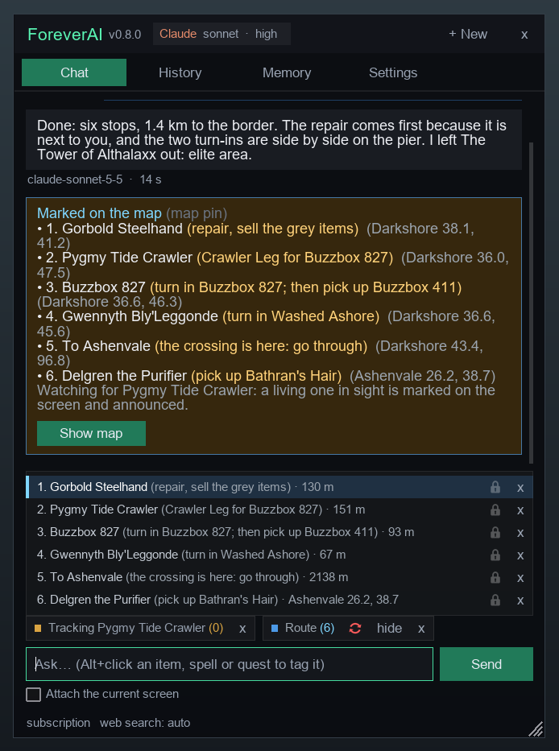
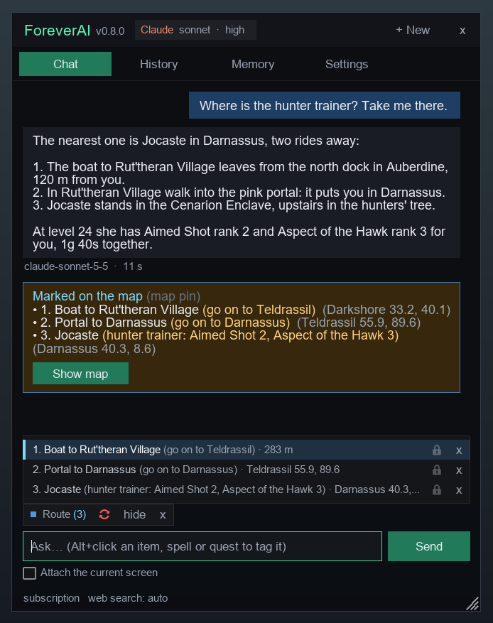
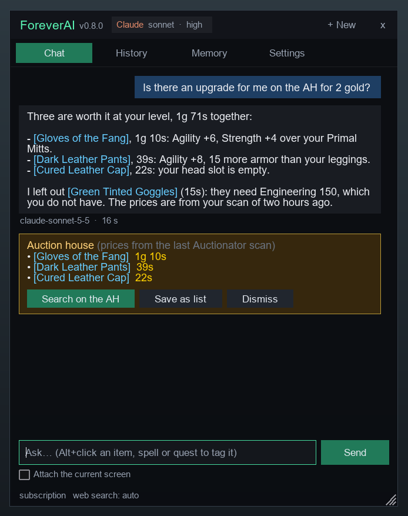
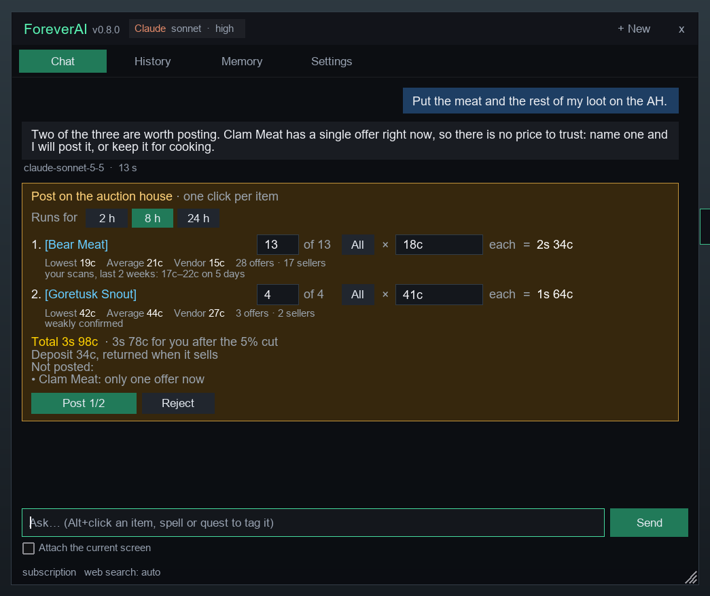
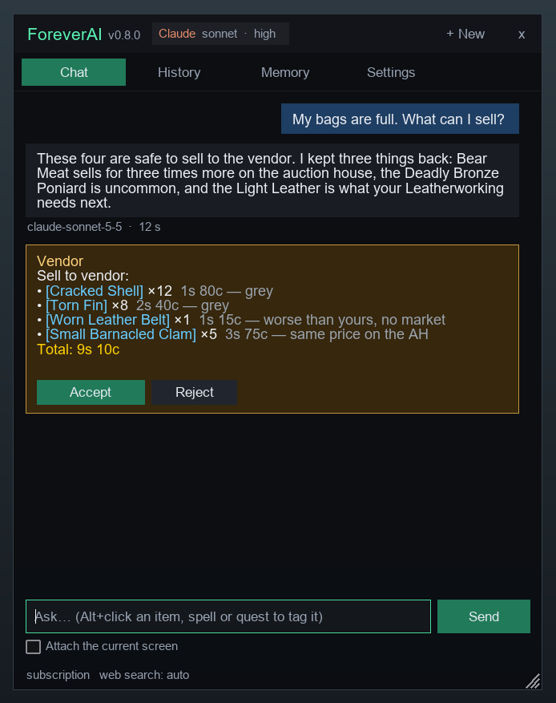
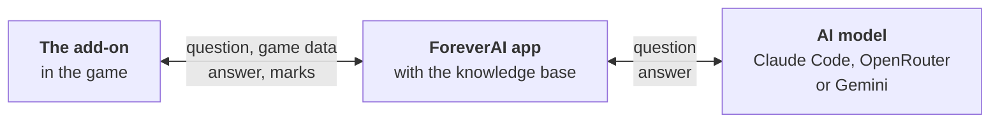
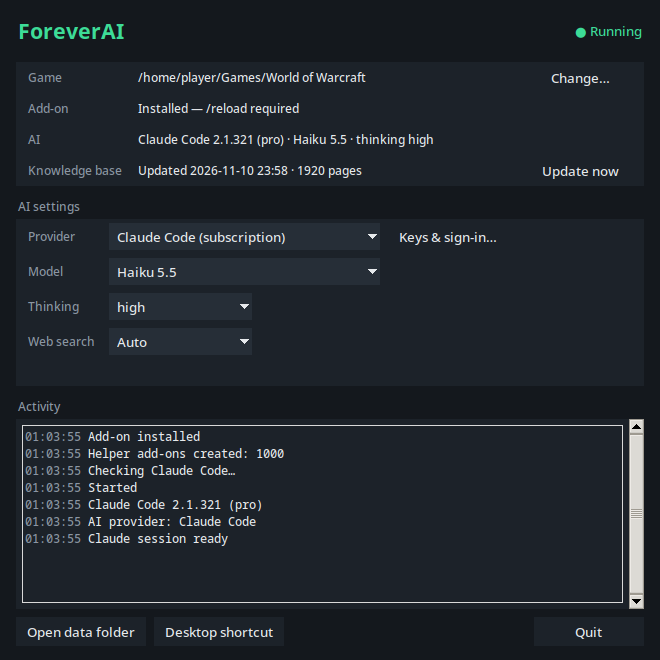
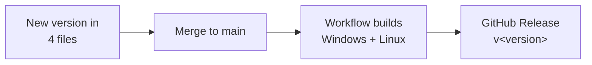

<div align="center">


# ForeverAI

**An AI companion inside World of Warcraft: Forever that already knows your character.**

[](https://github.com/pawelpieczonka/forever-ai/releases/latest)


[Get started](#get-started) · [What you can ask](#what-you-can-ask) · [More to ask](#more-to-ask) · [Choosing the AI](#choosing-the-ai) · [Other add-ons](#other-add-ons)

</div>

Ask in your own words, in any language. ForeverAI reads your quests, bags, gear, talents, pet and position from the game, so there is nothing to explain first. It answers from a knowledge base of what Forever changed, from the add-ons you have installed and, when it needs to, from the web.

<table>
<tr>
<td width="33%" valign="top">

**It knows your character**

Level, class, quests with their progress, what is in your bags, what you wear, where you stand. "Is this ring better than mine?" needs no more words than that.

</td>
<td width="33%" valign="top">

**It acts on the map**

A route through your quests with the real crossing into each zone, the boat, the flight master. Stops tick off when what is to be done there is done.

</td>
<td width="33%" valign="top">

**You stay in control**

Selling, posting an auction, repairing, changing an add-on's option: each is a card in the chat, and nothing happens until you click it.

</td>
</tr>
</table>

## What you can ask

<table>
<tr>
<td width="410"></td>
<td>

### "What should I do next?"

The answer is about your character as it is now: the quests you can finish here, what to leave for later, the upgrade on the way.

- "Which talent do I take now?"
- "Is this ring better than mine?" (Alt+click the ring)
- "Why do I keep dying to this mob?"
- "How long until level 30 at this pace?"

</td>
</tr>
<tr>
<td></td>
<td>

### "Plan a route through my quests"

The stops go on your map in walking order, each with what to do there. With TomTom, its arrow leads you from stop to stop.

- "…and repair on the way." "Add the flight master." What you ask for stays on the route until you have been there.
- "…and take what I can do on the way." Quests that cost no detour are taken along by themselves, in every zone of the route: the giver by the route, the whole quest no more than about 300 m of extra way, of your level (up to two levels above). Each is planned whole, from where you take it to where you turn it in.
- "Add the Deadmines quests, I have none of them yet." Quests to pick up are part of the route.
- "I already have the crawler legs, drop that stop."
- "Then go on to Ashenvale." The way into the next zone is a stop of its own, at the pass you walk through.

A stop is done when the quest is taken, the objective is finished or the quest is turned in, not when you walk past. The creature you need gets a marker over its nameplate and a sound when it comes into sight.

</td>
</tr>
<tr>
<td></td>
<td>

### "Where is the hunter trainer? Take me there."

Every step of the way is a stop: the boat and its dock, the portal, the tram, the flight master, the road across a border.

- "How do I get to Darnassus?"
- "Where do I buy Coarse Thread?"
- "Which flight paths near my route have I not opened?"
- "Mark the entrance of the Deadmines."

Flights are offered only between flight masters you have discovered, and a flight is named by its point on the flight map ("fly to Sentinel Hill, Westfall"), which is what you click there. A boat that goes on to a second harbour is one ride, and no way leads through a capital of the other faction.

</td>
</tr>
<tr>
<td></td>
<td>

### "Is there an upgrade for me on the AH for 2 gold?"

ForeverAI searches the prices of your last Auctionator scan slot by slot, compares each item with what you wear (with Pawn, by your own scales) and puts its picks on one shopping list under the answer. **Search on the AH** opens all of them in Auctionator's Shopping tab, **Save as list** keeps them as an Auctionator shopping list.

- The list is yours for the whole conversation: "and a helmet?" adds to it, and what you bought or what is no longer listed leaves it by itself.
- An item you cannot use is not a pick: one that needs a profession, a class or a reputation you do not have is left out, and the answer says what it requires. Ask for such items by name and you get them.
- "A one-handed sword up to 5 gold." "What is the cheapest 10-slot bag?" "What do the mats for Heavy Armor Kits cost?"
- "Make me an Auctionator list of these." Any items go on the list, also ones no search has priced; the card says which have no price in the last scan.

Buying always stays with you.

</td>
</tr>
<tr>
<td></td>
<td>

### "Put the meat and the rest on the AH."

With the auction house open, ForeverAI looks each item up there and then and shows one card: what to post, how many, for how much. Under each item stand the figures the price is based on: the lowest and the average price offered now, what a vendor pays, how many offers from how many sellers, and what your scans saw in the last two weeks.

The numbers are filled in, not fixed: type another count (the card says how many you have, **All** takes them all) or another price of one, or pick another length (2, 8 or 24 hours). What the lot comes to, the total, your share after the cut and the deposit follow at once.

- A price counts as sure when several sellers confirm it. With one offer on the market nothing is priced, unless you name the price.
- An item worth about the same at a vendor is not posted.
- "Post it for 24 hours." "50 silver each." Or change it on the card: a price is written like `1g 20s 5c`.
- "What do I have up? Cancel the three bear meat."

Each lot and each cancelled auction is one click of yours.

</td>
</tr>
<tr>
<td></td>
<td>

### "My bags are full. What can I sell?"

At a vendor you get a list with the reason for each item and one **Accept**. Hover an item on the card, here or on an auction card, and the game shows its tooltip, as in your bags.

- Kept back: anything uncommon or better, gear with stats, profession tools, crafting materials without a known price, and what sells for clearly more on the auction house.
- "Repair everything." is a card too.
- "How much gold did I make today, and on what?"

</td>
</tr>
</table>

<sub>The add-on's window with example answers, taken in the add-on simulator.</sub>

## More to ask

| Topic | Ask | Good to know |
|---|---|---|
| Gear | "What gear should I get next, and where from?" | with GearQuest Forever: the best items for each slot at your class and level, with the quest, vendor, creature or dungeon they come from |
| Professions | "What do I craft to get Leatherworking to 150 with what I have?" | |
| Selling | "My bags are full. What can I sell?" or "What in my bags is not worth selling on the AH?" | with Auctionator, vendor and auction prices side by side; nothing is sold until you click **Accept** |
| Gathering | "Where do I mine copper around here?" "Where are the fishing pools?" | with ForeverMapNotes: how many nodes a zone has and where they are densest |
| Rares and chests | "Which rares are in this zone, and what do they drop?" | with ForeverMapNotes |
| Hunter pets | "Which abilities can my cat learn now, and which beast teaches Bite 4?" | with Tamed: the easiest beast to reach comes first |
| Dungeons | "I want to do the Deadmines. Which quests do I need, and where do I get them?" | the quests of other zones are looked up, and their givers go on the route |
| Zones | "Where do I level from 24 to 30?" | with ForeverMapNotes: the level range of each zone, and the way there |
| What Forever changed | "What did the latest hotfixes change for hunters?" | from the knowledge base, with the sources under the answer |
| Other add-ons | "Turn off the Questie arrows on the minimap." | a proposal you accept; ForeverAI never changes another add-on's files |
| Memory | "Remember that I play Beast Mastery and level with a friend who plays a mage." | kept for later conversations; the **Memory** tab shows it |
| A long conversation | just keep talking | the app keeps notes of each conversation (what was agreed, what you corrected, what is still open), also after a restart |
| One thing | **Alt+click** an item, a spell or a quest | the question is about exactly that one |
| What is on the screen | tick **Attach the current screen** | the AI sees the screenshot with your question |

## How it works



Add-ons cannot reach the internet or other programs. So the add-on puts its question into a screenshot, which the app reads, and the app writes the answer into small helper add-ons (`ForeverAI_Inbox…`) that the add-on loads. That is why the app has to run while you play, and why the game needs one `/reload` after the add-on is installed.

## Get started

**You need:**

- Windows 10/11, or Linux with WoW Forever under Wine (Lutris, Steam/Proton, Bottles, Heroic or plain Wine)
- One AI: Claude Code (Claude subscription), an [OpenRouter key](https://openrouter.ai/keys) or a [Google Gemini API key](https://aistudio.google.com/apikey). See [Choosing the AI](#choosing-the-ai).
- **Questie**, for everything about quests: where their targets are, routes, quests to pick up, NPCs and flight masters. ForeverAI starts without it, but answers such questions from the quest text alone. [Seven more add-ons](#other-add-ons) are optional.

### 1. Download

From [the latest release](https://github.com/pawelpieczonka/forever-ai/releases/latest):

| System | File | Start |
|---|---|---|
| Windows 10/11 | `ForeverAI-<version>-Windows-x64.zip` | `ForeverAI-Windows/ForeverAI-Windows.exe` |
| Linux, glibc 2.35+ (Ubuntu 22.04, Debian 12 and later) | `ForeverAI-<version>-Linux-x86_64.tar.gz` | `ForeverAI-Linux/ForeverAI-Linux` |

No Python needed. `SHA256SUMS.txt` in the release has the checksums. The app tells you when a newer version is out (**Download update** in its window).

### 2. Start the app and reload the game

<table>
<tr>
<td width="330"></td>
<td>

Extract the file anywhere and start the app. It finds the game and installs the add-on.

Then type `/reload` in the game and click the **AI** button, or type `/fai`.

Keep the app running while you play. **Desktop shortcut** in its window puts it on the desktop (on Linux also in the application menu).

</td>
</tr>
</table>

<details>
<summary><b>Linux:</b> where the app looks for the game</summary>

<br>

In your Wine prefixes (`$WINEPREFIX`, Lutris, `~/.wine`, `~/Games`, Heroic, Bottles, Steam) and on mounted disks. If it does not find the game, choose the `World of Warcraft` folder in its window or start it with `--game-dir`.

The app finds Claude Code on `PATH`, in `~/.local/bin`, in npm/nvm installs and in the Claude desktop app.

</details>

## Choosing the AI

| | Claude Code | OpenRouter | Google Gemini |
|---|---|---|---|
| **You need** | a Claude subscription, Claude Code installed and signed in | an [OpenRouter key](https://openrouter.ai/keys) | a [Gemini API key](https://aistudio.google.com/apikey) |
| **Cost** | included in the subscription | per question, from your OpenRouter credit; free models cost nothing | Google's API prices for your key |
| **Models** | Haiku, Sonnet or Opus, with a thinking level | a list with the free models, or any model by its ID | a list, or any model by its ID |
| **When the model cannot answer** | — | a second model answers (for a free model, another free one) | `gemini-flash-lite-latest` answers within seconds |

- At start the app uses Claude Code when it is installed and signed in. Otherwise its window asks for a key and checks it with the provider before saving it.
- **AI settings** in the app window change the provider, the model, the thinking level and web search (Auto, Always or Off). **Keys & sign-in…** adds a key or signs in to Claude Code. Changes apply to the next question. **Route updates** picks another model for the updates the add-on asks for by itself (and, with Claude Code, another thinking level next to it), so that they can be faster or cheaper than your questions.
- Keys stay on your computer, in Windows Credential Manager or the Linux Secret Service (GNOME Keyring, KWallet, KeePassXC). Without one, the key is kept in `.env` in the data folder, readable only by you, and moves to the credential store once there is one.
- **Free OpenRouter models** (IDs ending in `:free`, and `openrouter/free`, which picks one) are at the end of the model list. OpenRouter allows 50 requests a day (1000 once you have bought 10 credits) and 20 a minute; each tool round of an answer is a request. The app window and the game's header show how many are left today. If a free model is busy, another free one answers, never a paid one. Web search is still paid per search, so with a free model it is used only while your balance is at least $0.10.
- When a Gemini answer has not started after 10 seconds, a short test tells an overloaded model from a busy one, so the switch to `gemini-flash-lite-latest` takes seconds instead of a long timeout. The app checks the chosen model again every few minutes and goes back to it once it answers.

## Other add-ons

| Add-on | Needed? | What ForeverAI gets from it | Without it |
|---|---|---|---|
| Questie | **needed for quests and routes** | where quest creatures, objects and items are, with drop chances and where they stand together; quests to pick up near you and in any other zone; NPCs with a role, the services your class uses, flight masters | no routes, no "where do I get this", no quest suggestions |
| TomTom | recommended | its arrow and waypoints for marks and routes | the game's own map pin, one at a time |
| Leatrix Maps | recommended | where the zones are joined (border crossings, boats, zeppelins, the tram, portals) and where each dungeon is entered, with its levels | a route into another zone has only the few ways built in; the AI looks the others up |
| Auctionator | optional | prices from your last scan (open the auction house and run a full scan first; what that scan did not see counts as sold); **Search on the AH** and **Save as list** on the shopping list | no auction prices, no shopping list |
| Pawn | optional | which items are upgrades for you, and which of a kind are the best for you | upgrades are judged from the item stats alone |
| GearQuest Forever | optional | the best items for each slot at your class, spec and level, and where each comes from (quest, vendor, creature, dungeon, profession), with the place | "what gear should I get" is answered from the items you have and the web |
| ForeverMapNotes | optional | rare creatures with their spawn spots and drops, ore, herbs, chests and fishing pools (how many and where they are densest), town NPCs of any zone, library books, the level range of each zone | "where do I mine copper", "which rares are here" are looked up on the web |
| Tamed | optional, for hunters | which abilities your pet's family can learn, the highest rank its level allows, and which beasts to tame for it, the easiest to reach first | pet abilities are answered from the web |

**Settings** in the add-on's window lists these eight with a tick or a cross: whether each one is loaded right now.

ForeverAI reads other add-ons and never changes their files. Their settings change only through a proposal you accept in the game.

## In the game

> [!IMPORTANT]
> Add-on options, selling, posting or cancelling an auction, repairing and abandoning a quest happen only after you click on the card. Buying on the auction house always stays with you.

| Do this | To |
|---|---|
| **Alt+click** an item, a spell or a quest | add it to your question |
| **Up** and **Down** in the text field | bring back what you asked before, like in a command line |
| the count, **All**, the price and **2 h / 8 h / 24 h** on an auction card | post something else than the AI proposed: what stands on the card at your click is what is posted |
| **Search on the AH** / **Save as list** on the shopping list | open every item of the list in Auctionator's Shopping tab, or keep them as an Auctionator shopping list |
| hover an item on a card (to post, to sell, the shopping list) | see the game's own tooltip of it, as in your bags; **Shift+click** puts it into the chat |
| **list** on the route | see its stops in order, each with what to do there in brackets and its distance; the one you are heading to is lit up |
| a click on a stop in the list | head there: the arrow leads to that stop |
| the padlock on a stop | keep it on the route until you unlock it |
| **x** on a stop | take it off the route |
| the arrows on the route (green or red) | have the AI update the route when your quests change, or not |
| **x** on the strip above the text field | stop tracking, or remove the route |
| **Settings** tab | choose which game data is sent, the font size, the AI button, whether new routes are updated when your quests change, the route alerts on the screen; see which AI is in use |

### How a route keeps up with you

- **A stop is done by what you do.** It comes off the route when the objective is finished, the quest is turned in or the quest is taken. A stop at a vendor, a trainer or a flight master is done when you have dealt with them; a stop that is only a place when you reach it; the way into another zone when you are in that zone.
- **The arrow says what the stop is for**, in brackets after its name: "turn in Buzzbox 827; then pick up Buzzbox 411". Of several things to do at a stop it says the ones that are left, and whose quest it is when two NPCs stand side by side. The way into the next zone says that the crossing is there.
- **With the arrows green the route follows your quest log.** What it was made for (an objective done, a quest turned in) ticks its stops off without asking the AI. A quest taken or turned in updates the route, once the stop you are at is done: two quests from one NPC are one update. An update adds what your quest log now needs and no quests you did not ask for: the quests on the way were chosen when the route was made, and the others offered around you are yours to ask for.
- **An update weaves into the route on the map.** The stops that stay keep their order (also the one you asked the AI for), their lock and the arrow; a new stop goes where it costs the least way from where you stand; a stop leaves only when nothing is left to do there. The AI looks at the result a moment later, knowing the stops you did lately, and when something has to change it changes the route right away, with one line in the chat: an update never waits for an **Accept**.
- **The next part of a chain is planned for.** Its stop says "turn in …; then pick up …" and stays until you took it.
- **Where the game has no data** (portals, boats, gates), the AI places the stop from what it knows and says when a spot is approximate. With Leatrix Maps installed, the crossings come from its map data.
- **Tracking** watches for every creature that counts for the same objective and stops by itself when the objective is done. While it tracks, the game shows the nameplates of all enemies; your own setting comes back afterwards.

| Command | What it does |
|---|---|
| `/fai` | opens or closes the window |
| `/fai <question>` | asks right away |
| `/fai new` | starts a new conversation |
| `/fai stop` | ends tracking and clears the marks |
| `/fai button` | shows or hides the AI button |
| `/fai status`, `/fai track`, `/fai debug` | details for troubleshooting |

**Troubleshooting.** The app keeps no log files unless you tick **Save logs to files** in its window; **Clear logs** next to it empties them.

## Uninstall

| Delete | Windows | Linux |
|---|---|---|
| The app | the extracted `ForeverAI-Windows` folder | the extracted `ForeverAI-Linux` folder |
| Your data | `%APPDATA%\ForeverAI` | `~/.local/share/foreverai` |
| The add-on | `ForeverAI` and `ForeverAI_Inbox*` in `World of Warcraft/_forever_/Interface/AddOns` | the same |
| Shortcuts | `ForeverAI.lnk` on the desktop | `~/.local/share/applications/foreverai.desktop` and `ForeverAI.desktop` on the desktop |

When the app runs from a git checkout, its data is in `companion/data`.

## Development

Python 3.12+ with your distribution's Tk (Linux: `sudo apt install python3-venv python3-tk`, `sudo dnf install python3-tkinter` or `sudo pacman -S tk`). A standalone Python (uv, python-build-standalone) has a Tk without font rendering, so the window shows bitmap fonts.

```bash
python3 -m venv companion/.venv
companion/.venv/bin/python -m pip install -r companion/requirements.txt
```

| To | Run in `companion` |
|---|---|
| start the app | `.venv/bin/python -m foreverai` |
| run the tests | `.venv/bin/python -m pytest -q` |
| run the add-on outside the game, connected to the app, and save pictures of its window | `.venv/bin/python -m addonsim --help` |

On Windows use `.venv\Scripts\python.exe` instead of `.venv/bin/python`.

<details>
<summary><b>Build the apps</b></summary>

<br>

The built apps are not committed. GitHub Actions (`.github/workflows/release.yml`) builds both from the same commit for every pull request (as workflow artifacts). Local builds go to `release/`, which git ignores. A Linux build runs on distributions with the same or a newer glibc than the machine that built it.

| Platform | Writes | With the flag, also |
|---|---|---|
| Windows | `release\windows\ForeverAI-Windows\` | `-Package`: the release zip |
| Linux | `release/linux/ForeverAI-Linux/` | `--package`: the release archive |

Windows:

```powershell
python -m venv companion\.venv
companion\.venv\Scripts\python.exe -m pip install -r companion\requirements.txt pyinstaller -c companion\constraints.txt
.\build_exe.ps1 -Package
```

Linux:

```bash
python3 -m venv companion/.venv
companion/.venv/bin/python -m pip install -r companion/requirements.txt pyinstaller -c companion/constraints.txt
./build_linux.sh --package
```

Both apps bundle the starter knowledge base `seed/kb.sqlite`. When `companion/data/kb.sqlite` exists, the app uses that one instead.

</details>

<details>
<summary><b>Publish a release</b></summary>

<br>



1. Set the new version in `addon/ForeverAI/ForeverAI.toc`, `ns.version` in `addon/ForeverAI/Core.lua`, `companion/foreverai/__init__.py` and `companion/pyproject.toml`. A test checks that they agree.
2. Merge to `main`. Since this version has no release yet, the workflow publishes `v<version>` (it creates the tag) with both files and `SHA256SUMS.txt`.

A push to `main` with a version that is already released only builds the apps. Pushing a tag `v<version>` that matches the version in the source publishes it as well.

</details>
